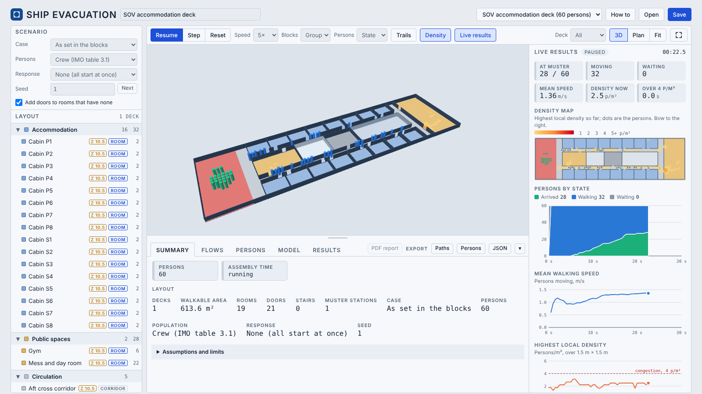

# Ship Evacuation

**Open the app: [shiplab.github.io/evac](https://shiplab.github.io/evac/)**

A web tool that simulates persons walking to the muster stations of a ship general arrangement, for early ship design. It reads the block format of the [Ship Design Building Block (DBB) Editor](https://shiplab.github.io/dbb/) and adds an optional `evac` field to each block. One HTML page, no installation; runs in any modern browser.

By Henrique M. Gaspar (NTNU). Based on the Ship Corridor Creator (T. Hinz, H. M. Gaspar, J. A. Rodriguez Perez) and the PRADS 2025 paper by T. Hinz, H. M. Gaspar, K. Bierkowska and G. Mazerski. Version 1.0.0, October 2026.

[](https://shiplab.github.io/evac/)

## What it does

- Builds the walkable decks from the blocks: cabins, corridors, public and work spaces, stairs and muster stations, with walls, doors and obstacles (tanks, columns, machinery).
- Fills them with persons from the IMO MSC.1/Circ.1533 population (age, gender and mobility groups, with their walking speeds on floors and stairs), as set per block or for the IMO night and day cases.
- Moves every person along the shortest route to a muster station with a Social Force model, and shows them walking in 3D.
- Gives the assembly time, the arrival curve, door and stair flows, the highest density and congestion, the muster space, and the route of every person, with live charts and density maps.
- Writes a PDF report of the case and the run, CSV and JSON exports, and saves the layout as a DBB project.

Indicative only, for early comparison of arrangements. One run is one random population, not an IMO evacuation analysis.

## Start

1. Open [the app](https://shiplab.github.io/evac/). It starts on an accommodation deck of a service operation vessel.
2. Press **Run**. Persons leave their cabins and walk to the muster station; the live results show beside the view.
3. Change the **Case** (as set, night, day), the **Response** or the **Seed**, or click a block and change its persons or doors, and run again.
4. **Results** has the charts and density maps after the run; **PDF report** writes the report.
5. **Open** reads your own layout (a DBB project `.json`), **Save** writes it back.

The **How to** button in the app has the steps, the file format, a glossary and the credits.

Examples in the app: an SOV accommodation deck, the same deck with equipment (obstacles), two decks with a stair, and IMO Test 4 (flow through a door). **Save** on an example gives a project file to start from.

## The evac field

```json
{ "id": "cabP1", "name": "Cabin P1", "shape": "box", "group": "g_acc",
  "position": [31, 5.3, 11.8], "size": [4, 3.4, 2.6], "rotation": [0, 0, 0],
  "evac": { "role": "room", "space": "cabin", "capacity": 2, "occupants": 2,
            "doors": [{ "face": "-y", "offset": 1.2, "width": 0.8 }] } }
```

- `role`: `room`, `corridor`, `open`, `stair`, `muster` or `obstacle`. A block without `evac` is an obstacle where it fills the walking height of a deck (0.3 to 1.0 m above it).
- Decks come from the bottoms of the walkable blocks. Rooms are entered only through their `doors`; corridors, open deck and muster stations that touch are open to each other. Stairs join one deck to the next.
- `space`, `capacity`, `occupants`, `population` and `muster` set the persons of a block.
- The top-level `evacuation` object holds the scenario (case, population, response, seed, project populations) and `results`, the summary of the last run with a signature of the arrangement, so a result shows as out of date when a block moves.

Every other field of a DBB project passes through untouched. A DBB project opened from disk keeps its arrangement read-only: Save changes only `evacuation`. The full field tables are under How to, Format, in the app.

## Model

- Population, walking speeds and response durations: IMO MSC.1/Circ.1533, Annex 3 (tables 3.1, 3.4, 3.5, section 3.2.2).
- Route: shortest walking distance to the muster station over a 0.1 m grid on all decks, linked at the stairs, kept a little off the walls.
- Movement: Social Force model (Helbing and Molnár; FDS+Evac; Montecchiari, Bulian and Gallina), one circle per person, calibrated on IMO Test 4 (1.1 to 1.25 persons/s through a 1 m door; IMO limit 1.33).
- Checked against IMO Tests 1, 2, 4, 5, 6 and 7.
- Not yet: repeated runs and the 95th percentile over runs, crew moving against the flow, fire or flooding cases, ship motions.

## Files

- `index.html`: the whole app in one page.
- `vendor/`: Three.js r147 and OrbitControls (MIT licence).

## Credits

- **Original app:** Ship Corridor Creator v0.1 (August 2024), Tomasz Hinz (Gdansk Tech) and Henrique M. Gaspar (NTNU), [gut.ntnu.co/evacuation](http://gut.ntnu.co/evacuation/); v0.2 (December 2025), Tomasz Hinz, Henrique M. Gaspar and Jesus A. Rodriguez Perez (Datasky), [wtif.pl/evacuation](https://wtif.pl/evacuation/).
- **Paper:** Hinz, T., Gaspar, H. M., Bierkowska, K. and Mazerski, G. (2025). Simulating and visualizing persons movement in deck arrangements: a web-based approach. PRADS 2025, Ann Arbor, MI, USA.
- **This app:** Henrique M. Gaspar (NTNU), with the block format, style and PDF writer of the [Ship Design Building Block Editor](https://shiplab.github.io/dbb/) (IMDC 2024, [doi:10.59490/imdc.2024.915](https://doi.org/10.59490/imdc.2024.915)). Code written with the help of Claude (Anthropic), an AI assistant, under the direction of the author.
- **Funding:** the research behind the PRADS 2025 paper was partly connected to the Smart European Shipbuilding (SEUS) project, Horizon Europe grant agreement No 101096224.

## References

- IMO (2016). MSC.1/Circ.1533, Revised guidelines on evacuation analysis for new and existing passenger ships. International Maritime Organization, London.
- Helbing, D. and Molnár, P. (1995). Social force model for pedestrian dynamics. Physical Review E, 51(5), 4282–4286. [doi:10.1103/PhysRevE.51.4282](https://doi.org/10.1103/PhysRevE.51.4282)
- Korhonen, T. and Hostikka, S. (2009). Fire Dynamics Simulator with Evacuation: FDS+Evac. Technical reference and user's guide. VTT Working Papers 119, Espoo.
- Montecchiari, G., Bulian, G. and Gallina, P. (2018). Towards real-time human participation in virtual evacuation through a validated simulation tool. Proc. IMechE Part O, 232(5), 476–490. [doi:10.1177/1748006X17705046](https://doi.org/10.1177/1748006X17705046)
- Montecchiari, G., Bulian, G. and Gallina, P. (2021). Ship evacuation simulation using a game engine: modelling, testing and validation. International Shipbuilding Progress, 68(2), 129–189. [doi:10.3233/ISP-210017](https://doi.org/10.3233/ISP-210017)
- Hinz, T., Gaspar, H. M., Bierkowska, K. and Mazerski, G. (2025). Simulating and visualizing persons movement in deck arrangements: a web-based approach. PRADS 2025, Ann Arbor, MI, USA.
